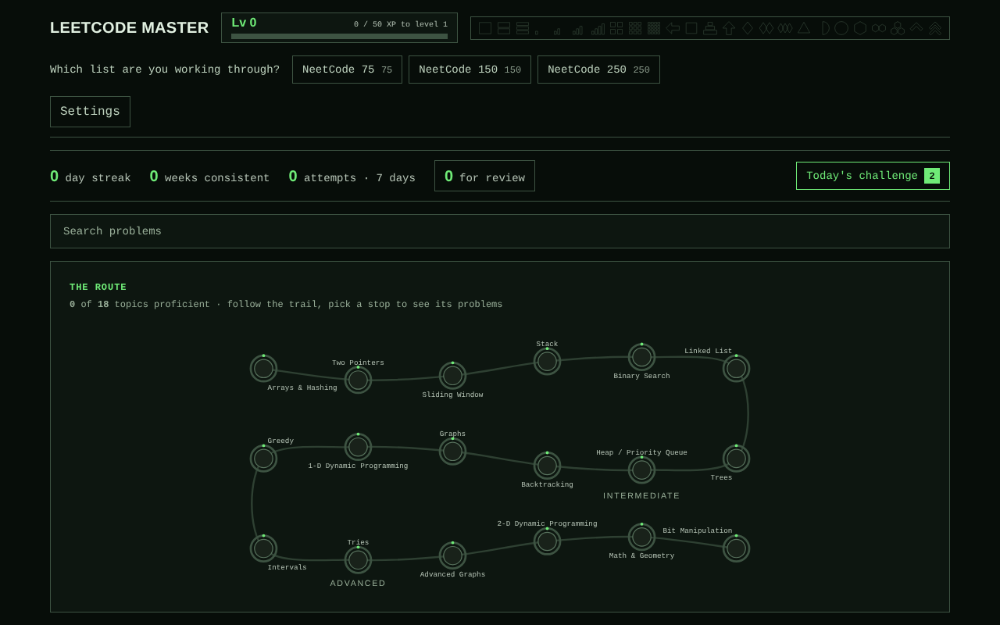
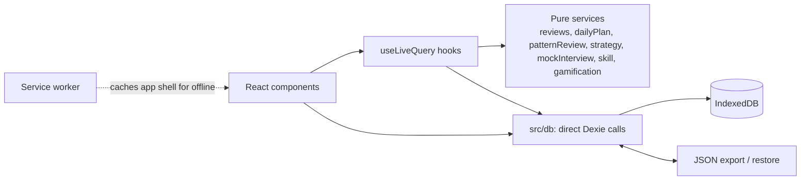

# LeetCode Master

[](https://github.com/Avrhambi/leetcode-master/actions/workflows/ci.yml)
[](LICENSE)

A local-first study coach for the NeetCode 75 / 150 / 250. It turns "grind
LeetCode until something sticks" into a directed, adaptive practice loop that
fights forgetting.

**Live demo:** <https://avrhambi.github.io/leetcode-master/>



## Why this exists

Almost everyone preparing for a software engineering interview ends up on
LeetCode, and most of them work through the NeetCode 75 / 150 / 250 — the widely-shared
curated lists that covers the patterns interviewers actually ask
about. It is the closest thing the field has to a standard syllabus.

The list tells you *what* to solve. It does not tell you *how to practise it*.

## The problem

Working through these lists on your own is frustrating in a specific way:

- **No direction.** You finish a problem and there is no answer to "what next?"
  You either march down the list in order or pick something at random. Neither
  reflects what you actually need to work on.
- **No steering.** Nothing reacts to how a problem *went*. Solving Two Sum in two
  minutes and barely scraping through a hard DP problem after watching the
  solution both just become a green checkmark. The list can't tell the
  difference, so it can't adjust.
- **No retention.** You "did" a topic three weeks ago and now you'd fail it cold.
  A flat checklist has no notion of review, so knowledge quietly decays while the
  list still shows it as done.
- **Blind spots get worse.** The topic you're weakest at is the one you avoid,
  and nothing pushes back — or, if you force yourself through it, nothing stops
  you from drowning in problems from the one area you're stuck on.

The result is a lot of effort spent without a sense of whether it's the *right*
effort, and no feedback loop to correct course.

## The solution

This wraps the NeetCode 75 / 150 / 250 in a coaching loop that reacts to your results.

**A daily plan, not a list.** Each day you get a short plan: two to four problems,
or as many as your daily time budget fits (30 to 120 minutes, up to eight
problems). It mixes new problems (exploring: a new variant of a pattern is what
prepares you for an unseen interview problem) with the reviews you actually owe
(consolidating), and neither is allowed to crash the other. Reviews take at most
a share of the plan, at least one new problem stays even when reviews pile up,
and only at twice the overload line is a day all reviews. New problems are chosen
by a priority score per topic — how foundational the topic is, how far along you
are in it, and how recently you last touched it — not a fixed march down the list.

**Patterns, not answers.** An interview asks a problem you have not seen, so the
app keeps *patterns* fresh rather than making you re-solve every problem five
times. A review is skipped (marked optional, still in the queue) while you have
solved a harder problem of the same topic since; each topic owes one review at a
time, its hardest; and a failed problem above your current level waits until
easier problems in the topic have brought you up to it.

**Built around your interview date.** Set a date and the plan changes strategy:
a *sprint* (two weeks or less) touches every pattern and keeps reviews for real
gaps; a *focused* or *steady* run spends new problems where one more raises your
odds most, with a bonus for topics you have barely practised (explore vs
exploit). In the last three days there are no new Hards: close gaps and run mock
interviews. **Interview readiness** — your estimated chance on an unseen Medium
in each topic — is in Progress, and on the main screen when nothing more urgent is.

**Mock interviews.** Pick one or two problems you have not seen, at your level,
under one clock: 30 minutes for one, 60 for two Easies, 90 when a Medium or Hard
is in the pair. Afterwards report each one: all tests passed, some passed (and
how many), or not working, and whether you used a hint. The results are saved as
ordinary attempts, count more toward your readiness than practice does, and
anything you missed comes back as a review.

**Every attempt steers the next one.** You record how a problem went — solved it
cleanly, needed a hint, watched the solution, couldn't do it — and that outcome
feeds back in. A weak result pulls the topic back up the priority list and
schedules a near-term review; a strong result lets the topic fade and pushes the
next review further out.

**Spaced repetition for retention.** Problems come back on an expanding schedule
(3 days → 1 week → 2 weeks → 1 month → mastered), so a topic you learned three
weeks ago resurfaces before you've lost it, not after; with pattern reviews, one
problem per topic carries that schedule for the rest.

**Blind-spot handling.** After a few failed attempts a problem is flagged as
*struggling*: its reviews back off to a 2/4/7-day ladder instead of hitting you
daily, and its topic stops flooding your plan with new problems from the area
you're stuck on — while still not unlocking that topic's *harder* problems until
you've genuinely made progress.

**Progress you can see.** The whole app is one screen that never scrolls. Its
centrepiece is a quest path — a winding trail through all 18 topics, lit behind
you and dim ahead, where each stop's ring fills as you master it and a cleared
topic earns a star. Alongside it: XP and levels for every attempt, milestone
badges, and a streak with a grace day for the day you miss. A topic you're stuck
on is marked in red, off the mastery scale entirely, so "needs a different
approach" can never be mistaken for progress.

Everything runs in the browser. Your data lives in IndexedDB — no account, no
server, no network calls — and you can export or import it as a single JSON file.

## The problem sets

One bundled catalog of 250 problems, with the **NeetCode 75** and **NeetCode 150**
flagged inside it (75 ⊂ 150 ⊂ 250). Pick a list in the header; the plan, map and
counts follow it. Switching lists never touches your stored progress, and reviews
for problems outside the chosen list keep coming due.

## Built for how you actually practise

- **Regular** (most days): steady new material, on-time reviews, daily and weekly streaks.
- **Occasional** (a few days a week): each short session goes to the reviews most
  at risk of being forgotten and to core problems first; weekly consistency counts.
- **Returning after a gap**: a gentle re-entry plan instead of a wall of overdue
  reviews. No XP or badge is ever lost.
- **New**: easy wins in foundation topics first, guided by a prerequisite graph.
- **Job hunting on a deadline**: an interview date, a daily time budget and mock
  interviews turn the plan into a training plan for the time you have.
- **Experienced**: "skip Easies" and "mark problems you already know" start you
  where you are.

Your profile and per-topic skill are derived from your attempt history, never
stored, so they cannot drift.

## Architecture

Everything is client-side. Rules are pure, deterministic functions that are unit
tested; Dexie calls are direct.



See [`CLAUDE.md`](CLAUDE.md) for the invariants and [`ROADMAP.md`](ROADMAP.md) for
the plan and decisions.

## Install as an app

It is a PWA that works offline. Open the live demo, then use your browser's
**Install** option (Chrome/Edge: the install icon in the address bar; Safari on
iOS: Share → Add to Home Screen). Settings shows whether persistent storage was
granted; export a backup regularly, because browser data can be cleared.

## Privacy

No server, no account, no telemetry, no network calls. Your history lives in
this browser's IndexedDB and leaves it only when you export a backup file.

## Disclaimer

Not affiliated with LeetCode or NeetCode. The app stores only problem titles,
metadata and links, never problem text. Links open neetcode.io, with the LeetCode
page as a secondary link.

## Running it

```bash
npm install
npm run dev      # dev server on the first free port from 8080
npm run verify   # lint, typecheck, tests, production build
```

Requires Node.js 22.12+. Stack: React 19 + TypeScript + Vite, Dexie/IndexedDB,
plain CSS. The NeetCode 250 catalog (with the 75 and 150 lists flagged inside it) is bundled — first launch seeds it and you're
ready to go.

Contributions are welcome: see [`CONTRIBUTING.md`](CONTRIBUTING.md). Licensed under
the [MIT License](LICENSE).

